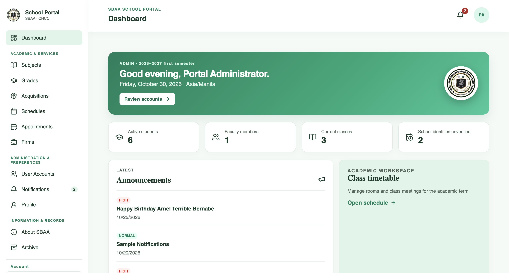
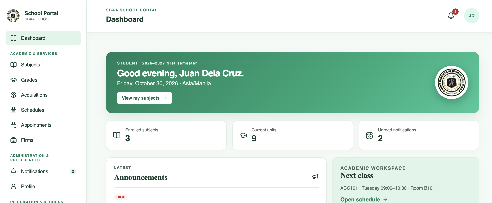
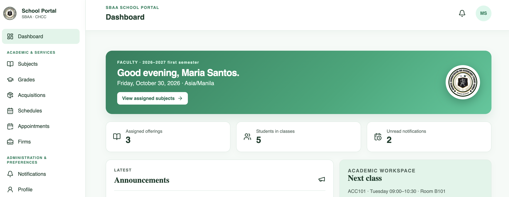
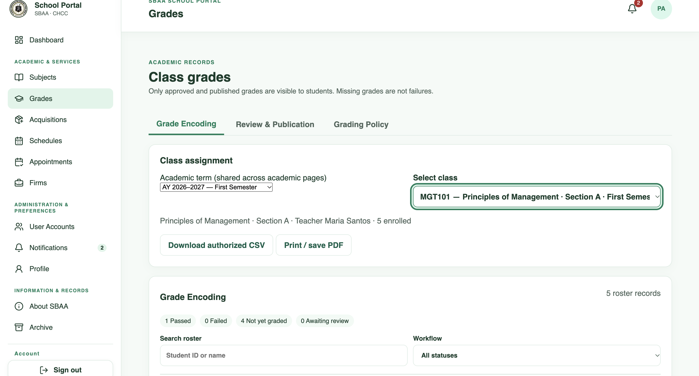
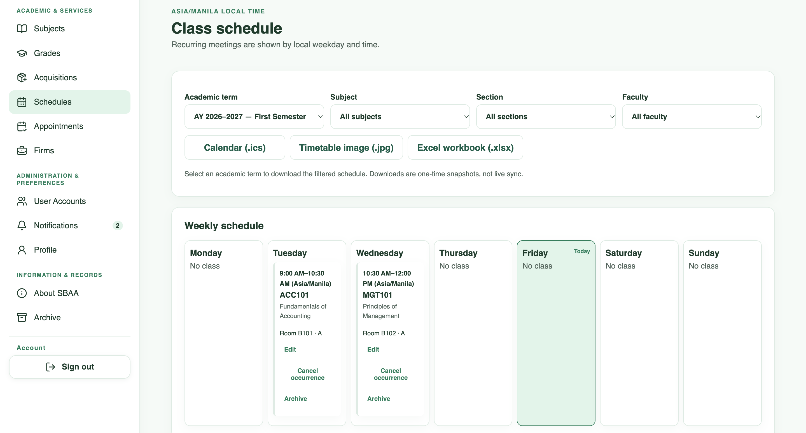

# SBAA School Management Portal

**Role-based academic management portal · Software Engineering 1 team project**

A Vue 3, Express, and MySQL application developed for the **School of Business Administration and Accountancy (SBAA), Concepcion Holy Cross College, Inc.** The project explores how administrators, faculty, and students can manage academic workflows through role-scoped interfaces.

> **Project status:** Ongoing academic development and pilot preparation. **Not an officially deployed production system.** Do not use real student records or assume production security approval.

**Tech stack:** Vue 3 · JavaScript · Node.js · Express · MySQL · HTML/CSS

## Application preview

<!-- Add REAL screenshots using fictional accounts and data. The paths below intentionally will not display until the files are added. -->

### Dashboard


### Role-specific experiences
 

### Academic workflows
 

*All published screenshots must use fictional data and must not expose account details, student IDs, access tokens, or personal records.*

## What the project does

- **Role-specific access:** administrator, faculty, and student dashboards; API-side role and account-status checks.
- **Academic records:** course/class administration, term-specific schedules, enrollment-scoped grade views, and faculty draft/publish workflows.
- **Accounts and profiles:** student registration, account management, profile preferences, session revocation, and email-change/reset workflows.
- **Communication:** announcements, personal in-app notifications, and class reminders.
- **Scheduling:** structured class meetings, conflict checks, schedule-image publication, `.ics` snapshots, and appointment requests.
- **Record oversight:** administrator-only actions, audit-oriented workflows, and a basic partner-firm directory.

These features describe development functionality, **not** an independently certified or institutionally approved system.

## Architecture

```text
Vue 3 frontend
      |
      | authenticated API requests
      v
Node.js + Express API
      |
      +---- MySQL (accounts, classes, grades, schedules, audits)
      |
      +---- Private file storage (local development / planned pilot adapter)
      |
      +---- Email provider configuration (delivery requires separate verification)
```

**Security note:** The development environment and planned production deployment have different session, storage, and configuration requirements. Review the technical reference and deployment checklist before operating beyond local fictional test data.

## My contribution

This is a **team academic project**. My work has included frontend and backend implementation, interface refinement, database/API integration, and test/deployment-preparation activities. The exact division of responsibility among team members should be verified against commit history and team documentation before using this section as a formal claim of sole authorship.

## Local development

**Prerequisites:** Node.js 20+, npm, MySQL 8+.

```bash
npm ci
npm ci --prefix server
npm ci --prefix client
# Configure server/.env locally using server/.env.example.
# On FIRST local setup only, initialize the schema as documented.
npm run db:migrate
npm run dev
```

Frontend: `http://localhost:5173` · API health: `http://localhost:5050/api/health` (default development ports).

**Do not run seeding, cleanup, or schema initialization against databases containing real records.** For the complete environment setup, seed prerequisites, and migration caveats, see [Technical reference](docs/TECHNICAL_REFERENCE.md).

## Verification and project status

The project provides build and database-backed development test commands. A successful local build or test is **not** proof of public production readiness, delivered email, or tested performance for 2,000 users.

```bash
npm run build
npm run test:integration --prefix server
```

Additional test suites, prerequisites, security assumptions, and unresolved issues are documented in the [technical reference](docs/TECHNICAL_REFERENCE.md) and [deployment checklist](DEPLOYMENT.md).

**Not yet verified for production:** end-to-end hosted deployment, school-approved identity/grade policies, independent security review, accessibility compliance, and load capacity. Some planned features such as transcripts and grade-file import remain out of scope.

## Documentation

- [Technical reference: detailed features, local setup, safety rules, and verification](docs/TECHNICAL_REFERENCE.md)
- [Deployment preparation and open blockers](DEPLOYMENT.md)

## Project context

Built for **Software Engineering 1** as a learning and system-design project. School branding is used in the academic-project context and does not imply that the college has officially adopted or deployed this software.
